<!-- Generated by `npm run assets` from the illustrations catalog. Do not edit it by hand. -->

<!-- art-hash: 7cf6478f8b008db9ca7c3e793ad0168afae4e018ce6c02ef907ddeb27993c5f8 -->

# WonderMap asset catalog

A picture of every illustration that ships with WonderMap: the terrains you paint with, the symbols you place, the scatter brushes, paths, label styles, fonts, themes and frames. None of it is a hand-made image: **the art is generated by code** (see [illustrations/README.md](illustrations/README.md)), and the pictures below are drawn by the app’s own engine, the one behind the editor and the image export.

> **This file is kept up to date automatically.** After adding or changing art, run `npm run assets` and commit `ASSETS.md` together with `docs/assets/`; `npm test` fails until you do.

## Contents

- [Terrains](#terrains) – 12 terrains
- [Symbols and brushes](#symbols-and-brushes) – 239 symbols in 11 categories, 63 brushes
  - [Mountains](#mountains) – 51 symbols, 16 brushes
  - [Forests & Trees](#forests--trees) – 13 symbols, 10 brushes
  - [Vegetation](#vegetation) – 50 symbols, 13 brushes
  - [Desert](#desert) – 18 symbols, 5 brushes
  - [Volcanoes & Caverns](#volcanoes--caverns) – 16 symbols, 4 brushes
  - [Settlements](#settlements) – 15 symbols
  - [Sea](#sea) – 29 symbols, 6 brushes
  - [Ice & Snow](#ice--snow) – 14 symbols, 5 brushes
  - [Swamp](#swamp) – 13 symbols, 4 brushes
  - [Landmarks](#landmarks) – 13 symbols
  - [Map Decor](#map-decor) – 7 symbols
- [Paths](#paths) – 5 path styles
- [Labels](#labels) – 12 label styles
- [Fonts](#fonts) – 7 fonts
- [Themes](#themes) – 2 themes
- [Frames](#frames) – 3 frames
- [How this file is made](#how-this-file-is-made)

## Terrains

The ground you paint with the **Terrain** tool. Each sample is a small island of the terrain in the sea, so you also see how it meets the water: the coastline, the sandy beach (on the terrains that have one) and the shallows. Drawn with the default theme.

<table>
<tr>
<td align="center" valign="top" width="33%">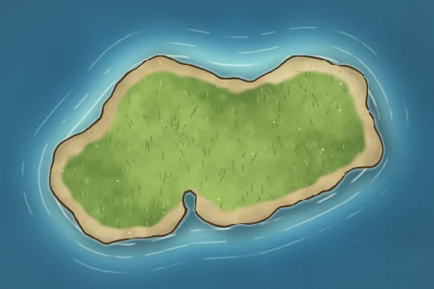 <b>Grassland</b> <code>grass</code> Green meadows and plains</td>
<td align="center" valign="top" width="33%">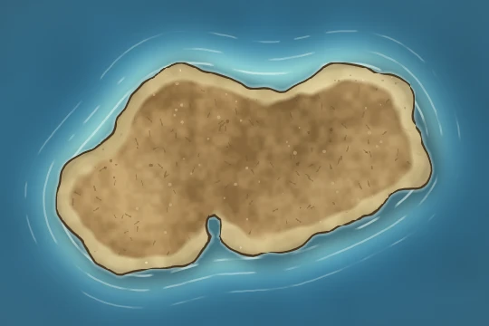 <b>Brown earth</b> <code>earth</code> Dry brown farmland, steppe and badlands</td>
<td align="center" valign="top" width="33%">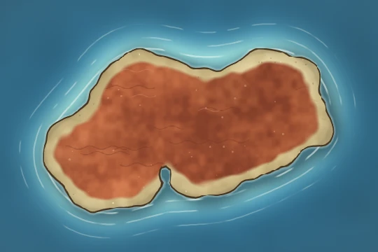 <b>Red lands</b> <code>clay</code> Red clay, canyons and scorched country</td>
</tr>
<tr>
<td align="center" valign="top" width="33%">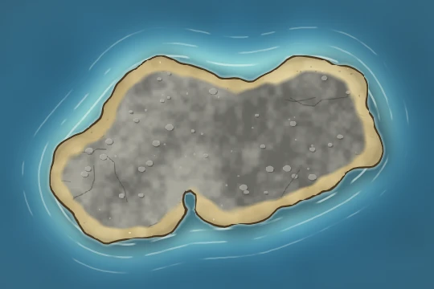 <b>Gray rock</b> <code>stone</code> Bare gray rock, scree and highlands</td>
<td align="center" valign="top" width="33%">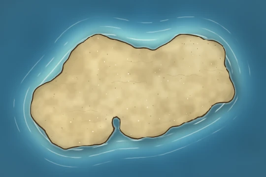 <b>Beach sand</b> <code>sand</code> Pale sand for beaches and shores</td>
<td align="center" valign="top" width="33%">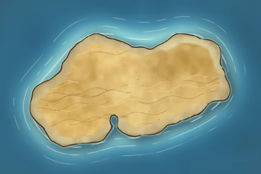 <b>Desert</b> <code>desert</code> Golden dunes</td>
</tr>
<tr>
<td align="center" valign="top" width="33%">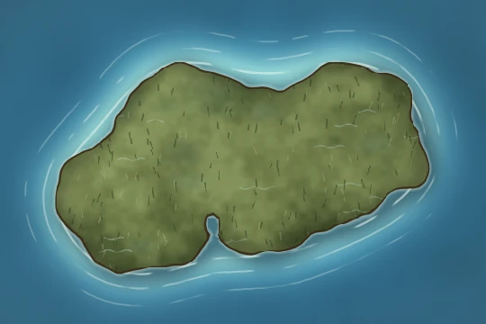 <b>Swamp</b> <code>swamp</code> Murky bogs and marshland</td>
<td align="center" valign="top" width="33%">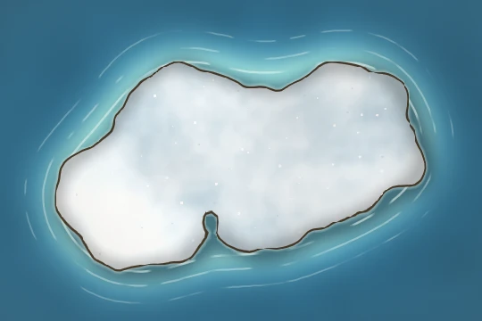 <b>Snow</b> <code>snow</code> Deep fresh snow</td>
<td align="center" valign="top" width="33%">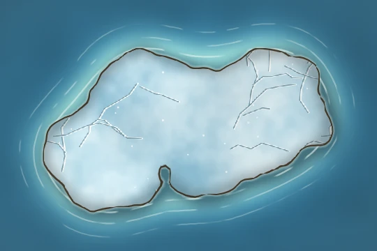 <b>Glacial ice</b> <code>ice</code> Blue cracked ice sheets</td>
</tr>
<tr>
<td align="center" valign="top" width="33%">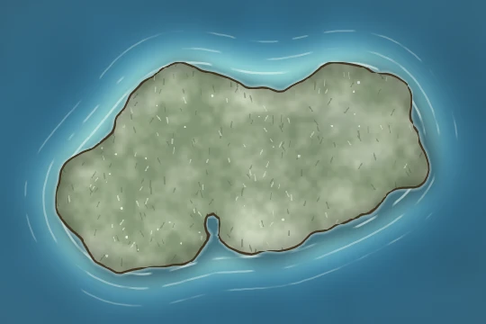 <b>Tundra</b> <code>tundra</code> Frosty moss and thin snow</td>
<td align="center" valign="top" width="33%">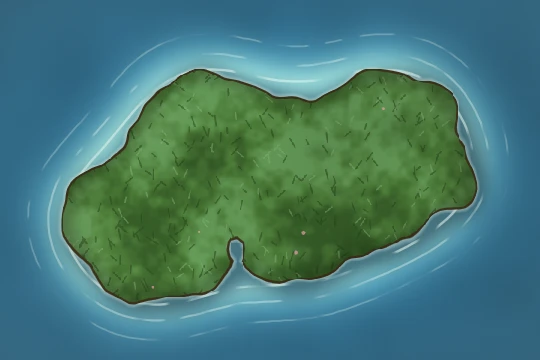 <b>Jungle floor</b> <code>jungle</code> Lush, dark tropical green</td>
<td align="center" valign="top" width="33%">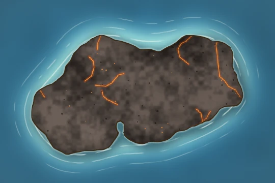 <b>Volcanic ash</b> <code>ash</code> Black cinder fields with glowing cracks</td>
</tr>
</table>

## Symbols and brushes

A **symbol** is one stamp you place with a click; a **brush** scatters a whole patch of them while you drag. Symbols are shown on the ground the palette shows them on (sea creatures on water, cacti on sand…). Every symbol has several variants and the picture shows the first one: the in-app **Art gallery** (`#/gallery`) shows them all.

### Mountains

Peaks, ranges, hills and rocky crags

**Brushes** (16): a patch painted with the brush, like dragging it over the map.

<table>
<tr>
<td align="center" valign="top" width="33%">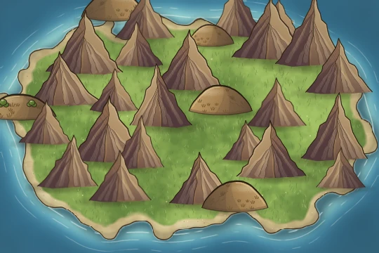 <b>Brown mountains</b> <code>mountains.brown</code> Paints Brown Mountain, Brown Hill spacing 62 px · size ×0.75–1.2</td>
<td align="center" valign="top" width="33%">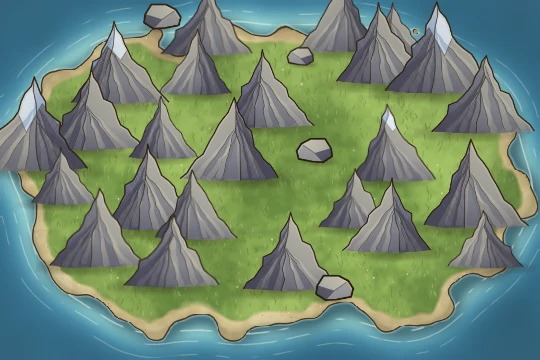 <b>Gray mountains</b> <code>mountains.gray</code> Paints Gray Mountain, Gray Snow Peak, Gray Boulder spacing 62 px · size ×0.75–1.2</td>
<td align="center" valign="top" width="33%">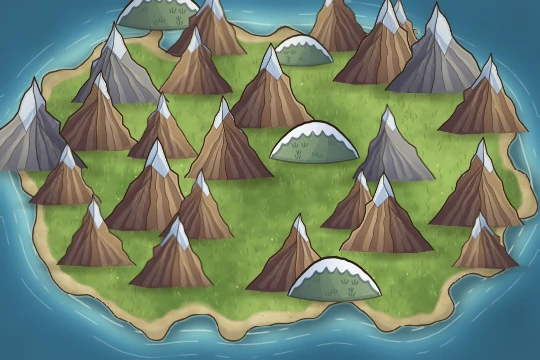 <b>Snowy peaks</b> <code>mountains.snowy</code> Paints Snow-capped Mountain, Gray Snow Peak, Snowy Hill spacing 62 px · size ×0.75–1.2</td>
</tr>
<tr>
<td align="center" valign="top" width="33%">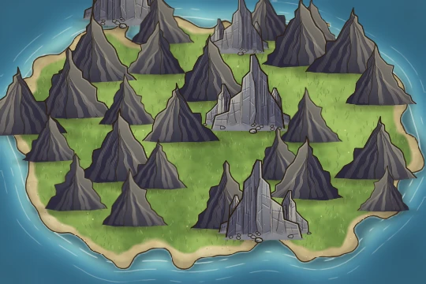 <b>Black mountains</b> <code>mountains.black</code> Paints Dark Mountain, Gray Crag spacing 62 px · size ×0.75–1.2</td>
<td align="center" valign="top" width="33%">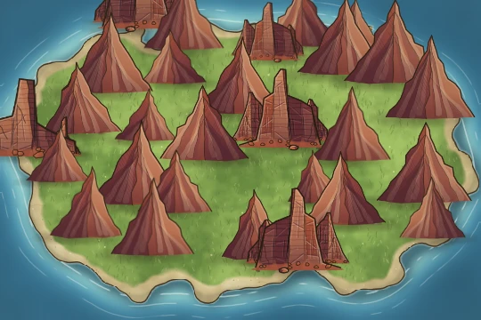 <b>Red mountains</b> <code>mountains.red</code> Paints Red Mountain, Red Crag spacing 62 px · size ×0.75–1.2</td>
<td align="center" valign="top" width="33%">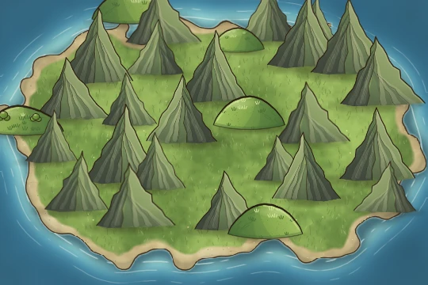 <b>Green mountains</b> <code>mountains.green</code> Paints Mossy Mountain, Green Hill spacing 62 px · size ×0.75–1.2</td>
</tr>
<tr>
<td align="center" valign="top" width="33%">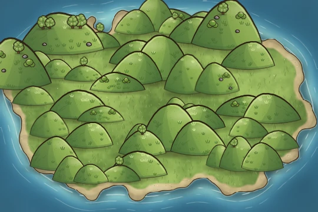 <b>Green hills</b> <code>hills.green</code> Paints Green Hill, Green Hill (Large), Green Hill Cluster spacing 54 px · size ×0.8–1.25</td>
<td align="center" valign="top" width="33%">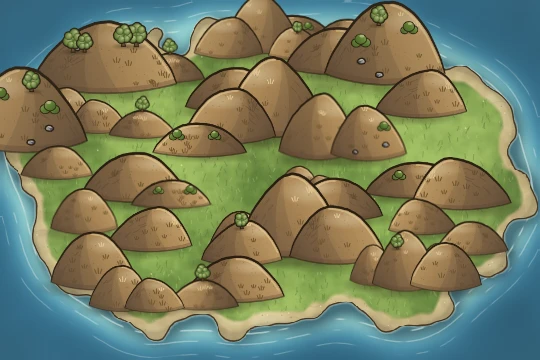 <b>Brown hills</b> <code>hills.brown</code> Paints Brown Hill, Brown Hill (Large), Brown Hill Cluster spacing 54 px · size ×0.8–1.25</td>
<td align="center" valign="top" width="33%">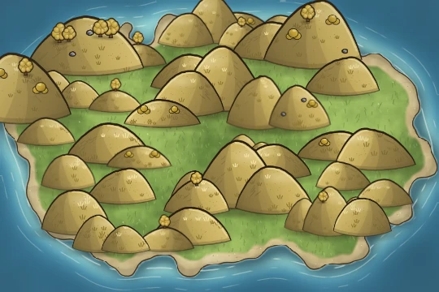 <b>Dry hills</b> <code>hills.dry</code> Paints Dry Hill, Dry Hill (Large), Dry Hill Cluster spacing 54 px · size ×0.8–1.25</td>
</tr>
<tr>
<td align="center" valign="top" width="33%">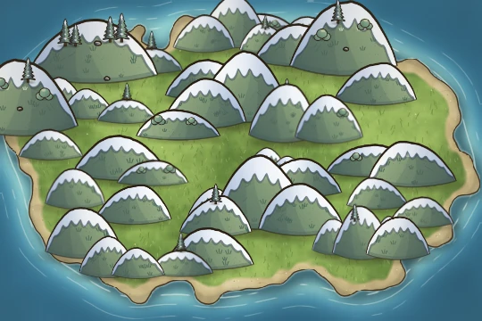 <b>Snowy hills</b> <code>hills.snowy</code> Paints Snowy Hill, Snowy Hill (Large), Snowy Hill Cluster spacing 54 px · size ×0.8–1.25</td>
<td align="center" valign="top" width="33%">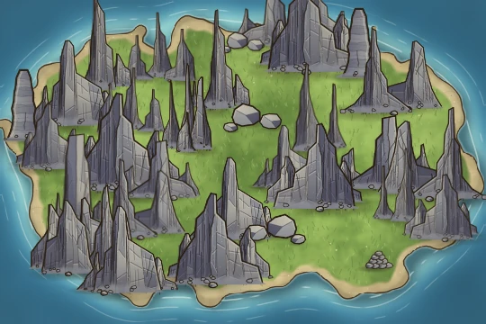 <b>Rocky crags</b> <code>crags.gray</code> Paints Gray Crag, Gray Crag Spire, Gray Boulders, Gray Rock Stack spacing 56 px · size ×0.75–1.2</td>
<td align="center" valign="top" width="33%">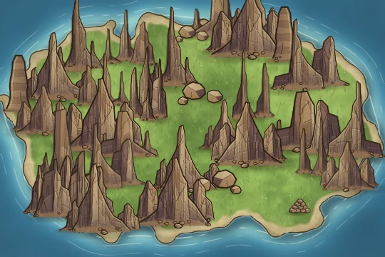 <b>Brown crags</b> <code>crags.brown</code> Paints Brown Crag, Brown Crag Spire, Brown Boulders, Brown Rock Stack spacing 56 px · size ×0.75–1.2</td>
</tr>
<tr>
<td align="center" valign="top" width="33%">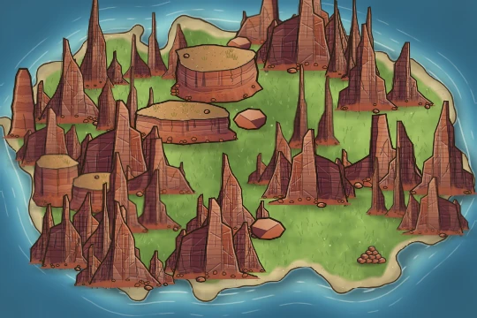 <b>Red crags</b> <code>crags.red</code> Paints Red Crag, Red Crag Spire, Red Boulder, Red Plateau +1 more spacing 56 px · size ×0.75–1.2</td>
<td align="center" valign="top" width="33%">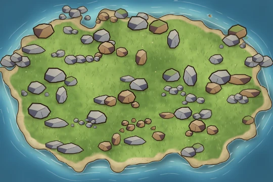 <b>Boulder field</b> <code>rocks.boulders</code> Paints Gray Boulder, Gray Boulders, Brown Boulder, Brown Boulders spacing 44 px · size ×0.7–1.3</td>
<td align="center" valign="top" width="33%">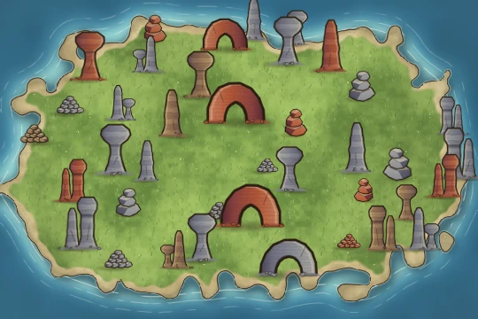 <b>Rock formations</b> <code>rocks.formations</code> Paints Gray Rock Stack, Brown Rock Stack, Red Rock Stack, Gray Rock Arch +1 more spacing 70 px · size ×0.8–1.2</td>
</tr>
<tr>
<td align="center" valign="top" width="33%">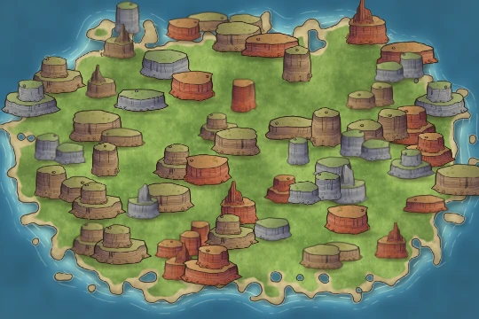 <b>Plateaus</b> <code>crags.plateaus</code> Paints Brown Plateau, Gray Plateau, Red Plateau spacing 86 px · size ×0.8–1.2</td>
</tr>
</table>

**Symbols** (51)

<table>
<tr>
<td align="center" valign="top" width="20%">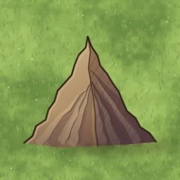 <b>Brown Mountain</b> <code>mountain.brown</code> 112 × 104 px · 6 variants</td>
<td align="center" valign="top" width="20%">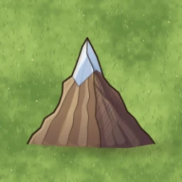 <b>Snow-capped Mountain</b> <code>mountain.snowy</code> 112 × 104 px · 6 variants</td>
<td align="center" valign="top" width="20%">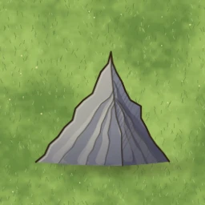 <b>Gray Mountain</b> <code>mountain.gray</code> 112 × 104 px · 6 variants</td>
<td align="center" valign="top" width="20%">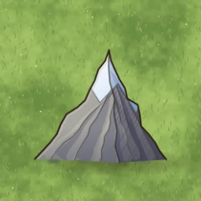 <b>Gray Snow Peak</b> <code>mountain.gray.snowy</code> 112 × 104 px · 6 variants</td>
<td align="center" valign="top" width="20%">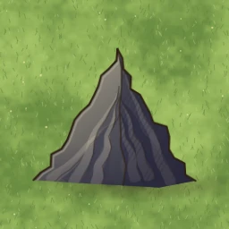 <b>Dark Mountain</b> <code>mountain.black</code> 112 × 104 px · 6 variants</td>
</tr>
<tr>
<td align="center" valign="top" width="20%">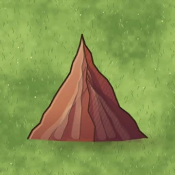 <b>Red Mountain</b> <code>mountain.red</code> 112 × 104 px · 6 variants</td>
<td align="center" valign="top" width="20%">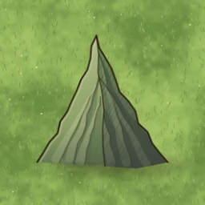 <b>Mossy Mountain</b> <code>mountain.green</code> 112 × 104 px · 6 variants</td>
<td align="center" valign="top" width="20%">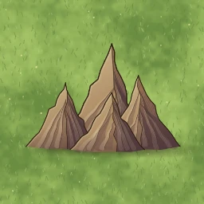 <b>Brown Range</b> <code>range.brown</code> 200 × 128 px · 6 variants</td>
<td align="center" valign="top" width="20%">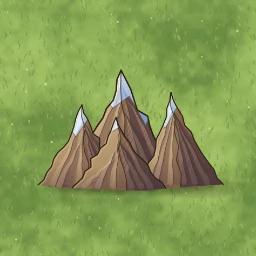 <b>Snow-capped Range</b> <code>range.snowy</code> 200 × 128 px · 6 variants</td>
<td align="center" valign="top" width="20%">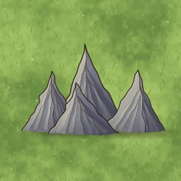 <b>Gray Range</b> <code>range.gray</code> 200 × 128 px · 6 variants</td>
</tr>
<tr>
<td align="center" valign="top" width="20%">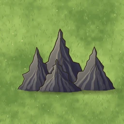 <b>Dark Range</b> <code>range.black</code> 200 × 128 px · 6 variants</td>
<td align="center" valign="top" width="20%">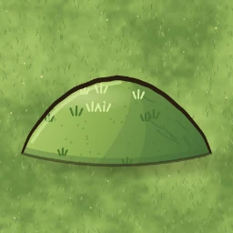 <b>Green Hill</b> <code>hill.green</code> 90 × 60 px · 6 variants</td>
<td align="center" valign="top" width="20%">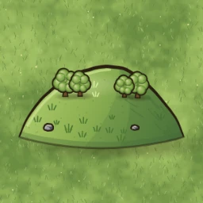 <b>Green Hill (Large)</b> <code>hill.green.big</code> 128 × 88 px · 5 variants</td>
<td align="center" valign="top" width="20%">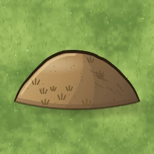 <b>Brown Hill</b> <code>hill.brown</code> 90 × 60 px · 6 variants</td>
<td align="center" valign="top" width="20%">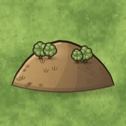 <b>Brown Hill (Large)</b> <code>hill.brown.big</code> 128 × 88 px · 5 variants</td>
</tr>
<tr>
<td align="center" valign="top" width="20%">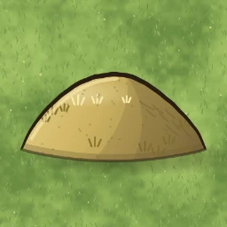 <b>Dry Hill</b> <code>hill.dry</code> 90 × 60 px · 6 variants</td>
<td align="center" valign="top" width="20%">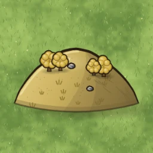 <b>Dry Hill (Large)</b> <code>hill.dry.big</code> 128 × 88 px · 5 variants</td>
<td align="center" valign="top" width="20%">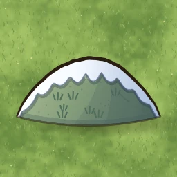 <b>Snowy Hill</b> <code>hill.snowy</code> 90 × 60 px · 6 variants</td>
<td align="center" valign="top" width="20%">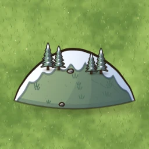 <b>Snowy Hill (Large)</b> <code>hill.snowy.big</code> 128 × 88 px · 5 variants</td>
<td align="center" valign="top" width="20%">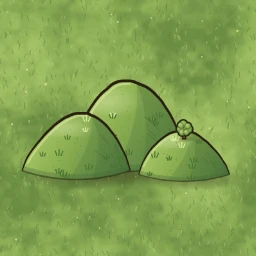 <b>Green Hill Cluster</b> <code>hill.cluster.green</code> 168 × 100 px · 5 variants</td>
</tr>
<tr>
<td align="center" valign="top" width="20%">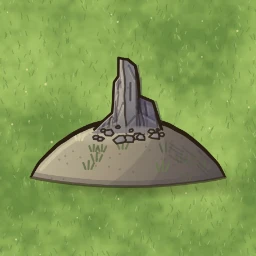 <b>Rocky Hill</b> <code>hill.rocky</code> 96 × 78 px · 5 variants</td>
<td align="center" valign="top" width="20%">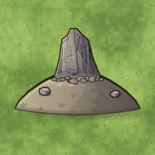 <b>Rocky Hill (Large)</b> <code>hill.rocky.big</code> 136 × 108 px · 4 variants</td>
<td align="center" valign="top" width="20%"> <b>Brown Hill Cluster</b> <code>hill.cluster.brown</code> 168 × 100 px · 5 variants</td>
<td align="center" valign="top" width="20%"> <b>Dry Hill Cluster</b> <code>hill.cluster.dry</code> 168 × 100 px · 5 variants</td>
<td align="center" valign="top" width="20%"> <b>Green Hill Range</b> <code>hill.range.green</code> 232 × 100 px · 4 variants</td>
</tr>
<tr>
<td align="center" valign="top" width="20%"> <b>Brown Hill Range</b> <code>hill.range.brown</code> 232 × 100 px · 4 variants</td>
<td align="center" valign="top" width="20%"> <b>Snowy Hill Cluster</b> <code>hill.cluster.snowy</code> 168 × 100 px · 5 variants</td>
<td align="center" valign="top" width="20%"> <b>Dry Hill Range</b> <code>hill.range.dry</code> 232 × 100 px · 4 variants</td>
<td align="center" valign="top" width="20%"> <b>Snowy Hill Range</b> <code>hill.range.snowy</code> 232 × 100 px · 4 variants</td>
<td align="center" valign="top" width="20%"> <b>Gray Crag</b> <code>crag.gray</code> 112 × 104 px · 6 variants</td>
</tr>
<tr>
<td align="center" valign="top" width="20%"> <b>Brown Crag</b> <code>crag.brown</code> 112 × 104 px · 6 variants</td>
<td align="center" valign="top" width="20%"> <b>Red Crag</b> <code>crag.red</code> 112 × 104 px · 6 variants</td>
<td align="center" valign="top" width="20%"> <b>Brown Plateau</b> <code>crag.plateau</code> 128 × 100 px · 6 variants</td>
<td align="center" valign="top" width="20%"> <b>Red Plateau</b> <code>crag.plateau.red</code> 128 × 100 px · 6 variants</td>
<td align="center" valign="top" width="20%"> <b>Gray Crag Spire</b> <code>crag.spire</code> 72 × 112 px · 6 variants</td>
</tr>
<tr>
<td align="center" valign="top" width="20%"> <b>Gray Plateau</b> <code>crag.plateau.gray</code> 128 × 100 px · 6 variants</td>
<td align="center" valign="top" width="20%"> <b>Brown Crag Spire</b> <code>crag.spire.brown</code> 72 × 112 px · 6 variants</td>
<td align="center" valign="top" width="20%"> <b>Red Crag Spire</b> <code>crag.spire.red</code> 72 × 112 px · 6 variants</td>
<td align="center" valign="top" width="20%"> <b>Gray Boulder</b> <code>rock.boulder</code> 48 × 40 px · 6 variants</td>
<td align="center" valign="top" width="20%"> <b>Gray Crag Range</b> <code>crag.range.gray</code> 200 × 128 px · 4 variants</td>
</tr>
<tr>
<td align="center" valign="top" width="20%"> <b>Gray Boulders</b> <code>rock.boulders</code> 76 × 48 px · 6 variants</td>
<td align="center" valign="top" width="20%"> <b>Brown Crag Range</b> <code>crag.range.brown</code> 200 × 128 px · 4 variants</td>
<td align="center" valign="top" width="20%"> <b>Brown Boulder</b> <code>rock.boulder.brown</code> 48 × 40 px · 6 variants</td>
<td align="center" valign="top" width="20%"> <b>Red Crag Range</b> <code>crag.range.red</code> 200 × 128 px · 4 variants</td>
<td align="center" valign="top" width="20%"> <b>Brown Boulders</b> <code>rock.boulders.brown</code> 76 × 48 px · 6 variants</td>
</tr>
<tr>
<td align="center" valign="top" width="20%"> <b>Red Boulder</b> <code>rock.boulder.red</code> 48 × 40 px · 6 variants</td>
<td align="center" valign="top" width="20%"> <b>Gray Rock Stack</b> <code>rock.stack</code> 56 × 76 px · 6 variants</td>
<td align="center" valign="top" width="20%"> <b>Brown Rock Stack</b> <code>rock.stack.brown</code> 56 × 76 px · 6 variants</td>
<td align="center" valign="top" width="20%"> <b>Red Rock Stack</b> <code>rock.stack.red</code> 56 × 76 px · 6 variants</td>
<td align="center" valign="top" width="20%"> <b>Gray Rock Arch</b> <code>rock.arch</code> 96 × 76 px · 3 variants</td>
</tr>
<tr>
<td align="center" valign="top" width="20%"> <b>Red Rock Arch</b> <code>rock.arch.red</code> 96 × 76 px · 3 variants</td>
</tr>
</table>

### Forests & Trees

Single trees and dense woods

**Brushes** (10): a patch painted with the brush, like dragging it over the map.

<table>
<tr>
<td align="center" valign="top" width="33%"> <b>Oak forest</b> <code>forest.oak</code> Paints Oak, Dark Oak, Green Bush spacing 34 px · size ×0.8–1.25</td>
<td align="center" valign="top" width="33%"> <b>Dark forest</b> <code>forest.dark</code> Paints Dark Oak, Pine, Dark Bush, Dead Tree spacing 30 px · size ×0.8–1.25</td>
<td align="center" valign="top" width="33%"> <b>Pine forest</b> <code>forest.pine</code> Paints Pine, Dark Oak, Dark Bush spacing 30 px · size ×0.8–1.2</td>
</tr>
<tr>
<td align="center" valign="top" width="33%"> <b>Snowy pines</b> <code>forest.snowy</code> Paints Snowy Pine, Pine, Dead Tree spacing 30 px · size ×0.8–1.2</td>
<td align="center" valign="top" width="33%"> <b>Autumn forest</b> <code>forest.autumn</code> Paints Autumn Tree, Oak, Autumn Bush spacing 34 px · size ×0.8–1.25</td>
<td align="center" valign="top" width="33%"> <b>Blossom grove</b> <code>forest.blossom</code> Paints Blossom Tree, Oak, Flowering Bush spacing 38 px · size ×0.8–1.2</td>
</tr>
<tr>
<td align="center" valign="top" width="33%"> <b>Palm grove</b> <code>forest.palm</code> Paints Palm, Green Bush, Fern spacing 46 px · size ×0.8–1.2</td>
<td align="center" valign="top" width="33%"> <b>Jungle</b> <code>forest.jungle</code> Paints Palm, Dark Oak, Deep Fern, Dark Bush +1 more spacing 30 px · size ×0.8–1.3</td>
<td align="center" valign="top" width="33%"> <b>Dead woods</b> <code>forest.dead</code> Paints Dead Tree, Tree Stump, Fallen Log spacing 40 px · size ×0.8–1.2</td>
</tr>
<tr>
<td align="center" valign="top" width="33%"> <b>Forest patches</b> <code>forest.patches</code> Paints Oak Grove, Dark Oak Grove, Pine Grove, Autumn Tree Grove spacing 96 px · size ×0.8–1.2</td>
</tr>
</table>

**Symbols** (13)

<table>
<tr>
<td align="center" valign="top" width="20%"> <b>Oak</b> <code>tree.oak</code> 56 × 64 px · 8 variants</td>
<td align="center" valign="top" width="20%"> <b>Dark Oak</b> <code>tree.oak.dark</code> 56 × 64 px · 8 variants</td>
<td align="center" valign="top" width="20%"> <b>Autumn Tree</b> <code>tree.autumn</code> 56 × 64 px · 8 variants</td>
<td align="center" valign="top" width="20%"> <b>Blossom Tree</b> <code>tree.blossom</code> 56 × 64 px · 8 variants</td>
<td align="center" valign="top" width="20%"> <b>Pine</b> <code>tree.pine</code> 48 × 68 px · 8 variants</td>
</tr>
<tr>
<td align="center" valign="top" width="20%"> <b>Snowy Pine</b> <code>tree.pine.snowy</code> 48 × 68 px · 8 variants</td>
<td align="center" valign="top" width="20%"> <b>Palm</b> <code>tree.palm</code> 64 × 68 px · 8 variants</td>
<td align="center" valign="top" width="20%"> <b>Dead Tree</b> <code>tree.dead</code> 56 × 64 px · 8 variants</td>
<td align="center" valign="top" width="20%"> <b>Oak Grove</b> <code>grove.oak</code> 132 × 96 px · 6 variants</td>
<td align="center" valign="top" width="20%"> <b>Dark Oak Grove</b> <code>grove.oak.dark</code> 132 × 96 px · 6 variants</td>
</tr>
<tr>
<td align="center" valign="top" width="20%"> <b>Autumn Tree Grove</b> <code>grove.autumn</code> 132 × 96 px · 6 variants</td>
<td align="center" valign="top" width="20%"> <b>Pine Grove</b> <code>grove.pine</code> 132 × 96 px · 6 variants</td>
<td align="center" valign="top" width="20%"> <b>Snowy Pine Grove</b> <code>grove.pine.snowy</code> 132 × 96 px · 6 variants</td>
</tr>
</table>

### Vegetation

Bushes, grass, flowers, crops

**Brushes** (13): a patch painted with the brush, like dragging it over the map.

<table>
<tr>
<td align="center" valign="top" width="33%"> <b>Meadow</b> <code>veg.meadow</code> Paints Grass Tuft, Grass Tufts, Yellow Buttercups, White Daisies +3 more spacing 26 px · size ×0.8–1.3</td>
<td align="center" valign="top" width="33%"> <b>Tall grass</b> <code>veg.tall-grass</code> Paints Tall Grass, Lush Grass, Grass Tuft spacing 28 px · size ×0.8–1.3</td>
<td align="center" valign="top" width="33%"> <b>Dry grass</b> <code>veg.dry-grass</code> Paints Dry Grass, Dry Grass Tuft, Dry Bush spacing 28 px · size ×0.8–1.3</td>
</tr>
<tr>
<td align="center" valign="top" width="33%"> <b>Flower field</b> <code>veg.flowers</code> Paints Red Poppies, Yellow Buttercups, White Daisies, Bluebells +3 more spacing 28 px · size ×0.8–1.3</td>
<td align="center" valign="top" width="33%"> <b>Bushes</b> <code>veg.bushes</code> Paints Green Bush, Dark Bush, Flowering Bush, Berry Bush spacing 34 px · size ×0.8–1.3</td>
<td align="center" valign="top" width="33%"> <b>Thicket</b> <code>veg.thicket</code> Paints Briar Thicket, Dark Bush, Wild Roses, Bramble Berries spacing 34 px · size ×0.8–1.3</td>
</tr>
<tr>
<td align="center" valign="top" width="33%"> <b>Ferns</b> <code>veg.ferns</code> Paints Fern, Deep Fern, Tall Bracken, Autumn Fern spacing 32 px · size ×0.8–1.3</td>
<td align="center" valign="top" width="33%"> <b>Mushroom patch</b> <code>veg.mushrooms</code> Paints Fly Agaric, Brown Mushrooms, Orange Mushrooms, Violet Mushrooms +1 more spacing 30 px · size ×0.8–1.3</td>
<td align="center" valign="top" width="33%"> <b>Farmland</b> <code>veg.farmland</code> Paints Wheat Field, Vegetable Patch, Cornfield, Plowed Field +2 more spacing 58 px · size ×0.9–1.15</td>
</tr>
<tr>
<td align="center" valign="top" width="33%"> <b>Wheat fields</b> <code>veg.wheat</code> Paints Wheat Field, Haystack, Hay Bales spacing 58 px · size ×0.9–1.15</td>
<td align="center" valign="top" width="33%"> <b>Stumps &amp; logs</b> <code>veg.fallen-wood</code> Paints Tree Stump, Fallen Log, Birch Stump, Mossy Log spacing 52 px · size ×0.8–1.25</td>
<td align="center" valign="top" width="33%"> <b>Briars &amp; ivy</b> <code>veg.briars</code> Paints Briar Thicket, Wild Roses, Bramble Berries, Ivy spacing 38 px · size ×0.8–1.25</td>
</tr>
<tr>
<td align="center" valign="top" width="33%"> <b>Vineyards</b> <code>veg.vineyard</code> Paints Creeping Vines, Grape Vines, Flowering Vines spacing 40 px · size ×0.85–1.2</td>
</tr>
</table>

**Symbols** (50)

<table>
<tr>
<td align="center" valign="top" width="20%"> <b>Fern</b> <code>plant.fern</code> 46 × 40 px · 6 variants</td>
<td align="center" valign="top" width="20%"> <b>Fly Agaric</b> <code>plant.mushroom</code> 42 × 38 px · 6 variants</td>
<td align="center" valign="top" width="20%"> <b>Grass Tuft</b> <code>grass.tuft</code> 30 × 24 px · 6 variants</td>
<td align="center" valign="top" width="20%"> <b>Green Bush</b> <code>bush.green</code> 48 × 40 px · 6 variants</td>
<td align="center" valign="top" width="20%"> <b>Red Poppies</b> <code>flower.red</code> 44 × 40 px · 6 variants</td>
</tr>
<tr>
<td align="center" valign="top" width="20%"> <b>Wheat Field</b> <code>crop.wheat</code> 64 × 54 px · 6 variants</td>
<td align="center" valign="top" width="20%"> <b>Vegetable Patch</b> <code>crop.green</code> 64 × 54 px · 6 variants</td>
<td align="center" valign="top" width="20%"> <b>Cornfield</b> <code>crop.corn</code> 64 × 54 px · 6 variants</td>
<td align="center" valign="top" width="20%"> <b>Pumpkin Patch</b> <code>crop.pumpkin</code> 64 × 54 px · 6 variants</td>
<td align="center" valign="top" width="20%"> <b>Brown Mushrooms</b> <code>plant.mushroom.brown</code> 42 × 38 px · 6 variants</td>
</tr>
<tr>
<td align="center" valign="top" width="20%"> <b>Dark Bush</b> <code>bush.dark</code> 48 × 40 px · 6 variants</td>
<td align="center" valign="top" width="20%"> <b>Deep Fern</b> <code>plant.fern.dark</code> 46 × 40 px · 6 variants</td>
<td align="center" valign="top" width="20%"> <b>Grass Tufts</b> <code>grass.tufts</code> 58 × 30 px · 6 variants</td>
<td align="center" valign="top" width="20%"> <b>Plowed Field</b> <code>farm.field</code> 76 × 50 px · 6 variants</td>
<td align="center" valign="top" width="20%"> <b>Yellow Buttercups</b> <code>flower.yellow</code> 44 × 40 px · 6 variants</td>
</tr>
<tr>
<td align="center" valign="top" width="20%"> <b>Autumn Bush</b> <code>bush.autumn</code> 48 × 40 px · 6 variants</td>
<td align="center" valign="top" width="20%"> <b>Autumn Fern</b> <code>plant.fern.golden</code> 46 × 40 px · 6 variants</td>
<td align="center" valign="top" width="20%"> <b>Haystack</b> <code>farm.haystack</code> 46 × 48 px · 6 variants</td>
<td align="center" valign="top" width="20%"> <b>Lush Grass</b> <code>grass.lush</code> 44 × 34 px · 6 variants</td>
<td align="center" valign="top" width="20%"> <b>Orange Mushrooms</b> <code>plant.mushroom.orange</code> 42 × 38 px · 6 variants</td>
</tr>
<tr>
<td align="center" valign="top" width="20%"> <b>White Daisies</b> <code>flower.white</code> 44 × 40 px · 6 variants</td>
<td align="center" valign="top" width="20%"> <b>Hay Bales</b> <code>farm.bales</code> 60 × 40 px · 6 variants</td>
<td align="center" valign="top" width="20%"> <b>Flowering Bush</b> <code>bush.flowering</code> 48 × 40 px · 6 variants</td>
<td align="center" valign="top" width="20%"> <b>Lavender</b> <code>flower.purple</code> 44 × 40 px · 6 variants</td>
<td align="center" valign="top" width="20%"> <b>Tall Bracken</b> <code>plant.bracken</code> 44 × 52 px · 6 variants</td>
</tr>
<tr>
<td align="center" valign="top" width="20%"> <b>Tall Grass</b> <code>grass.tall</code> 48 × 52 px · 6 variants</td>
<td align="center" valign="top" width="20%"> <b>Violet Mushrooms</b> <code>plant.mushroom.purple</code> 42 × 38 px · 6 variants</td>
<td align="center" valign="top" width="20%"> <b>Bluebells</b> <code>flower.blue</code> 44 × 40 px · 6 variants</td>
<td align="center" valign="top" width="20%"> <b>Dry Grass</b> <code>grass.dry</code> 46 × 46 px · 6 variants</td>
<td align="center" valign="top" width="20%"> <b>Glowshrooms</b> <code>plant.mushroom.glow</code> 42 × 38 px · 6 variants</td>
</tr>
<tr>
<td align="center" valign="top" width="20%"> <b>Homestead</b> <code>farm.homestead</code> 124 × 92 px · 6 variants</td>
<td align="center" valign="top" width="20%"> <b>White Flowering Bush</b> <code>bush.flowering.white</code> 48 × 40 px · 6 variants</td>
<td align="center" valign="top" width="20%"> <b>Dry Grass Tuft</b> <code>grass.dry.tuft</code> 30 × 24 px · 6 variants</td>
<td align="center" valign="top" width="20%"> <b>Lilac Bush</b> <code>bush.flowering.purple</code> 48 × 40 px · 6 variants</td>
<td align="center" valign="top" width="20%"> <b>Tree Stump</b> <code>plant.stump</code> 40 × 38 px · 6 variants</td>
</tr>
<tr>
<td align="center" valign="top" width="20%"> <b>Tulips</b> <code>flower.tulip</code> 44 × 40 px · 6 variants</td>
<td align="center" valign="top" width="20%"> <b>Birch Stump</b> <code>plant.stump.birch</code> 40 × 38 px · 6 variants</td>
<td align="center" valign="top" width="20%"> <b>Berry Bush</b> <code>bush.berry</code> 48 × 40 px · 6 variants</td>
<td align="center" valign="top" width="20%"> <b>Fallen Log</b> <code>plant.log</code> 66 × 34 px · 6 variants</td>
<td align="center" valign="top" width="20%"> <b>Wildflower Meadow</b> <code>flower.meadow</code> 64 × 44 px · 6 variants</td>
</tr>
<tr>
<td align="center" valign="top" width="20%"> <b>Blueberry Bush</b> <code>bush.berry.blue</code> 48 × 40 px · 6 variants</td>
<td align="center" valign="top" width="20%"> <b>Mossy Log</b> <code>plant.log.mossy</code> 66 × 34 px · 6 variants</td>
<td align="center" valign="top" width="20%"> <b>Briar Thicket</b> <code>plant.briar</code> 52 × 44 px · 6 variants</td>
<td align="center" valign="top" width="20%"> <b>Dry Bush</b> <code>bush.dry</code> 48 × 40 px · 6 variants</td>
<td align="center" valign="top" width="20%"> <b>Wild Roses</b> <code>plant.briar.rose</code> 52 × 44 px · 6 variants</td>
</tr>
<tr>
<td align="center" valign="top" width="20%"> <b>Bramble Berries</b> <code>plant.briar.berry</code> 52 × 44 px · 6 variants</td>
<td align="center" valign="top" width="20%"> <b>Ivy</b> <code>plant.ivy</code> 46 × 36 px · 6 variants</td>
<td align="center" valign="top" width="20%"> <b>Creeping Vines</b> <code>plant.vines</code> 50 × 38 px · 6 variants</td>
<td align="center" valign="top" width="20%"> <b>Grape Vines</b> <code>plant.vines.grape</code> 50 × 38 px · 6 variants</td>
<td align="center" valign="top" width="20%"> <b>Flowering Vines</b> <code>plant.vines.flower</code> 50 × 38 px · 6 variants</td>
</tr>
</table>

### Desert

Dunes, cacti, oases, dry bones

**Brushes** (5): a patch painted with the brush, like dragging it over the map.

<table>
<tr>
<td align="center" valign="top" width="33%"> <b>Dunes</b> <code>desert.dunes</code> Paints Sand Dune, Sand Dunes spacing 64 px · size ×0.8–1.3</td>
<td align="center" valign="top" width="33%"> <b>Cacti</b> <code>desert.cacti</code> Paints Saguaro Cactus, Barrel Cactus, Prickly Pear, Cactus Garden spacing 46 px · size ×0.8–1.25</td>
<td align="center" valign="top" width="33%"> <b>Desert scrub</b> <code>desert.scrub</code> Paints Dry Bush, Dry Grass, Dry Grass Tuft, Cracked Earth +1 more spacing 34 px · size ×0.8–1.3</td>
</tr>
<tr>
<td align="center" valign="top" width="33%"> <b>Mesas &amp; buttes</b> <code>desert.mesas</code> Paints Mesa, Butte, Sandstone Spires, Rock Arch spacing 92 px · size ×0.8–1.2</td>
<td align="center" valign="top" width="33%"> <b>Bones &amp; tumbleweed</b> <code>desert.bones</code> Paints Tumbleweed, Dead desert tree, Skull and bones spacing 60 px · size ×0.8–1.25</td>
</tr>
</table>

**Symbols** (18)

<table>
<tr>
<td align="center" valign="top" width="20%"> <b>Saguaro Cactus</b> <code>cactus.saguaro</code> 56 × 76 px · 6 variants</td>
<td align="center" valign="top" width="20%"> <b>Barrel Cactus</b> <code>cactus.barrel</code> 48 × 38 px · 6 variants</td>
<td align="center" valign="top" width="20%"> <b>Prickly Pear</b> <code>cactus.prickly-pear</code> 52 × 44 px · 6 variants</td>
<td align="center" valign="top" width="20%"> <b>Cactus Garden</b> <code>desert.cactus-group</code> 104 × 84 px · 6 variants</td>
<td align="center" valign="top" width="20%"> <b>Sand Dune</b> <code>desert.dune</code> 104 × 58 px · 6 variants</td>
</tr>
<tr>
<td align="center" valign="top" width="20%"> <b>Sand Dunes</b> <code>desert.dunes</code> 152 × 76 px · 6 variants</td>
<td align="center" valign="top" width="20%"> <b>Cracked Earth</b> <code>desert.cracked</code> 76 × 54 px · 6 variants</td>
<td align="center" valign="top" width="20%"> <b>Mesa</b> <code>desert.mesa</code> 116 × 96 px · 6 variants</td>
<td align="center" valign="top" width="20%"> <b>Butte</b> <code>desert.butte</code> 84 × 112 px · 6 variants</td>
<td align="center" valign="top" width="20%"> <b>Sandstone Spires</b> <code>desert.spires</code> 104 × 108 px · 6 variants</td>
</tr>
<tr>
<td align="center" valign="top" width="20%"> <b>Rock Arch</b> <code>desert.rock-arch</code> 104 × 96 px · 6 variants</td>
<td align="center" valign="top" width="20%"> <b>Pyramid</b> <code>desert.pyramid</code> 104 × 88 px · 6 variants</td>
<td align="center" valign="top" width="20%"> <b>Pyramids</b> <code>desert.pyramids</code> 150 × 100 px · 6 variants</td>
<td align="center" valign="top" width="20%"> <b>Oasis</b> <code>desert.oasis</code> 140 × 100 px · 6 variants</td>
<td align="center" valign="top" width="20%"> <b>Nomad camp</b> <code>desert.camp</code> 120 × 88 px · 6 variants</td>
</tr>
<tr>
<td align="center" valign="top" width="20%"> <b>Skull and bones</b> <code>desert.skull</code> 60 × 42 px · 6 variants</td>
<td align="center" valign="top" width="20%"> <b>Tumbleweed</b> <code>desert.tumbleweed</code> 40 × 34 px · 6 variants</td>
<td align="center" valign="top" width="20%"> <b>Dead desert tree</b> <code>desert.dead-tree</code> 56 × 64 px · 6 variants</td>
</tr>
</table>

### Volcanoes & Caverns

Volcanoes, craters, cave mouths

**Brushes** (4): a patch painted with the brush, like dragging it over the map.

<table>
<tr>
<td align="center" valign="top" width="33%"> <b>Lava fields</b> <code>volcanic.lava</code> Paints Lava Flow, Lava Pool spacing 66 px · size ×0.8–1.3</td>
<td align="center" valign="top" width="33%"> <b>Volcanic peaks</b> <code>volcanic.peaks</code> Paints Ash Cone, Dormant Volcano, Active Volcano, Caldera spacing 110 px · size ×0.8–1.15</td>
<td align="center" valign="top" width="33%"> <b>Geysers &amp; hot springs</b> <code>volcanic.springs</code> Paints Hot Spring, Geyser, Sinkhole spacing 72 px · size ×0.8–1.25</td>
</tr>
<tr>
<td align="center" valign="top" width="33%"> <b>Rifts &amp; sinkholes</b> <code>volcanic.fissures</code> Paints Chasm, Sinkhole, Gray Boulders spacing 80 px · size ×0.8–1.3</td>
</tr>
</table>

**Symbols** (16)

<table>
<tr>
<td align="center" valign="top" width="20%"> <b>Active Volcano</b> <code>volcano.active</code> 140 × 120 px · 4 variants</td>
<td align="center" valign="top" width="20%"> <b>Erupting Volcano</b> <code>volcano.erupting</code> 160 × 150 px · 4 variants</td>
<td align="center" valign="top" width="20%"> <b>Dormant Volcano</b> <code>volcano.dormant</code> 128 × 104 px · 6 variants</td>
<td align="center" valign="top" width="20%"> <b>Snow-capped Volcano</b> <code>volcano.snowy</code> 128 × 108 px · 5 variants</td>
<td align="center" valign="top" width="20%"> <b>Ash Cone</b> <code>volcano.ash</code> 120 × 100 px · 5 variants</td>
</tr>
<tr>
<td align="center" valign="top" width="20%"> <b>Caldera</b> <code>volcano.crater</code> 136 × 88 px · 6 variants</td>
<td align="center" valign="top" width="20%"> <b>Geyser</b> <code>volcano.geyser</code> 76 × 100 px · 6 variants</td>
<td align="center" valign="top" width="20%"> <b>Hot Spring</b> <code>volcano.hotspring</code> 84 × 64 px · 6 variants</td>
<td align="center" valign="top" width="20%"> <b>Cave Entrance</b> <code>cave.entrance</code> 100 × 86 px · 5 variants</td>
<td align="center" valign="top" width="20%"> <b>Hill Cave</b> <code>cave.hill</code> 112 × 84 px · 5 variants</td>
</tr>
<tr>
<td align="center" valign="top" width="20%"> <b>Crystal Cave</b> <code>cave.crystal</code> 100 × 86 px · 5 variants</td>
<td align="center" valign="top" width="20%"> <b>Mine Entrance</b> <code>cave.mine</code> 100 × 86 px · 4 variants</td>
<td align="center" valign="top" width="20%"> <b>Sinkhole</b> <code>cave.sinkhole</code> 84 × 64 px · 6 variants</td>
<td align="center" valign="top" width="20%"> <b>Chasm</b> <code>cave.rift</code> 120 × 56 px · 6 variants</td>
<td align="center" valign="top" width="20%"> <b>Lava Flow</b> <code>lava.flow</code> 136 × 68 px · 5 variants</td>
</tr>
<tr>
<td align="center" valign="top" width="20%"> <b>Lava Pool</b> <code>lava.pool</code> 84 × 64 px · 6 variants</td>
</tr>
</table>

### Settlements

Villages, towns, cities, castles, ports

**Symbols** (15)

<table>
<tr>
<td align="center" valign="top" width="20%"> <b>Hamlet</b> <code>settlement.hamlet</code> 84 × 64 px · 6 variants</td>
<td align="center" valign="top" width="20%"> <b>Village</b> <code>settlement.village</code> 112 × 80 px · 6 variants</td>
<td align="center" valign="top" width="20%"> <b>Town</b> <code>settlement.town</code> 144 × 100 px · 6 variants</td>
<td align="center" valign="top" width="20%"> <b>Fort</b> <code>settlement.fort</code> 128 × 104 px · 5 variants</td>
<td align="center" valign="top" width="20%"> <b>Walled Town</b> <code>settlement.walled-town</code> 168 × 126 px · 5 variants</td>
</tr>
<tr>
<td align="center" valign="top" width="20%"> <b>Ruined Town</b> <code>settlement.ruins</code> 150 × 110 px · 5 variants</td>
<td align="center" valign="top" width="20%"> <b>Castle</b> <code>castle.keep</code> 168 × 136 px · 5 variants</td>
<td align="center" valign="top" width="20%"> <b>Fortress</b> <code>castle.fortress</code> 184 × 152 px · 4 variants</td>
<td align="center" valign="top" width="20%"> <b>Dark Castle</b> <code>castle.dark</code> 168 × 160 px · 4 variants</td>
<td align="center" valign="top" width="20%"> <b>Castle Ruins</b> <code>castle.ruins</code> 168 × 136 px · 4 variants</td>
</tr>
<tr>
<td align="center" valign="top" width="20%"> <b>Fortified Tower</b> <code>castle.tower</code> 112 × 128 px · 5 variants</td>
<td align="center" valign="top" width="20%"> <b>City</b> <code>settlement.city</code> 196 × 150 px · 5 variants</td>
<td align="center" valign="top" width="20%"> <b>Capital</b> <code>settlement.city.large</code> 248 × 190 px · 4 variants</td>
<td align="center" valign="top" width="20%"> <b>Port</b> <code>settlement.port</code> 180 × 128 px · 4 variants</td>
<td align="center" valign="top" width="20%"> <b>Shipyard</b> <code>settlement.shipyard</code> 180 × 128 px · 2 variants</td>
</tr>
</table>

### Sea

Ships, wrecks, islands, sea monsters

**Brushes** (6): a patch painted with the brush, like dragging it over the map.

<table>
<tr>
<td align="center" valign="top" width="33%"> <b>Sea rocks</b> <code>sea.rocks</code> Paints Sea Rock spacing 76 px · size ×0.6–1.3</td>
<td align="center" valign="top" width="33%"> <b>Reefs &amp; islets</b> <code>sea.reefs</code> Paints Shallow Reef, Sea Rocks, Sandy Islet spacing 108 px · size ×0.7–1.2</td>
<td align="center" valign="top" width="33%"> <b>Kelp forest</b> <code>sea.kelp</code> Paints Kelp spacing 70 px · size ×0.8–1.3</td>
</tr>
<tr>
<td align="center" valign="top" width="33%"> <b>Waves</b> <code>sea.waves</code> Paints Waves spacing 84 px · size ×0.8–1.5</td>
<td align="center" valign="top" width="33%"> <b>Fishing boats</b> <code>sea.boats</code> Paints Fishing Boat, Rowboat spacing 130 px · size ×0.8–1.15</td>
<td align="center" valign="top" width="33%"> <b>Shipwrecks</b> <code>sea.wrecks</code> Paints Small Wreck, Broken Mast, Shipwreck spacing 190 px · size ×0.8–1.1</td>
</tr>
</table>

**Symbols** (29)

<table>
<tr>
<td align="center" valign="top" width="20%"> <b>Cog</b> <code>ship.cog</code> 112 × 98 px · 6 variants</td>
<td align="center" valign="top" width="20%"> <b>Galleon</b> <code>ship.galleon</code> 140 × 132 px · 5 variants</td>
<td align="center" valign="top" width="20%"> <b>Caravel</b> <code>ship.caravel</code> 112 × 104 px · 5 variants</td>
<td align="center" valign="top" width="20%"> <b>Pirate Ship</b> <code>ship.pirate</code> 140 × 132 px · 4 variants</td>
<td align="center" valign="top" width="20%"> <b>Longship</b> <code>ship.longship</code> 150 × 92 px · 5 variants</td>
</tr>
<tr>
<td align="center" valign="top" width="20%"> <b>Galley</b> <code>ship.galley</code> 150 × 88 px · 4 variants</td>
<td align="center" valign="top" width="20%"> <b>Fishing Boat</b> <code>boat.fishing</code> 78 × 68 px · 5 variants</td>
<td align="center" valign="top" width="20%"> <b>Rowboat</b> <code>boat.rowboat</code> 56 × 38 px · 4 variants</td>
<td align="center" valign="top" width="20%"> <b>Fleet</b> <code>boat.fleet</code> 210 × 124 px · 5 variants</td>
<td align="center" valign="top" width="20%"> <b>Sea Serpent</b> <code>serpent.sea</code> 200 × 96 px · 4 variants</td>
</tr>
<tr>
<td align="center" valign="top" width="20%"> <b>Coiled Sea Serpent</b> <code>serpent.sea.coiled</code> 136 × 150 px · 4 variants</td>
<td align="center" valign="top" width="20%"> <b>Sea Dragon</b> <code>serpent.dragon</code> 224 × 130 px · 4 variants</td>
<td align="center" valign="top" width="20%"> <b>Kraken</b> <code>sea.kraken</code> 200 × 160 px · 4 variants</td>
<td align="center" valign="top" width="20%"> <b>Whale</b> <code>sea.whale</code> 168 × 104 px · 4 variants</td>
<td align="center" valign="top" width="20%"> <b>Wooden Pier</b> <code>sea.pier</code> 152 × 76 px · 4 variants</td>
</tr>
<tr>
<td align="center" valign="top" width="20%"> <b>Shipwreck</b> <code>wreck.ship</code> 150 × 112 px · 5 variants</td>
<td align="center" valign="top" width="20%"> <b>Small Wreck</b> <code>wreck.ship.small</code> 112 × 84 px · 4 variants</td>
<td align="center" valign="top" width="20%"> <b>Broken Mast</b> <code>wreck.mast</code> 64 × 96 px · 4 variants</td>
<td align="center" valign="top" width="20%"> <b>Beached Wreck</b> <code>wreck.beached</code> 150 × 100 px · 4 variants</td>
<td align="center" valign="top" width="20%"> <b>Ship Graveyard</b> <code>wreck.graveyard</code> 260 × 170 px · 4 variants</td>
</tr>
<tr>
<td align="center" valign="top" width="20%"> <b>Wrecked Shipyard</b> <code>wreck.shipyard</code> 232 × 150 px · 4 variants</td>
<td align="center" valign="top" width="20%"> <b>Ruined Dock</b> <code>wreck.dock</code> 152 × 76 px · 4 variants</td>
<td align="center" valign="top" width="20%"> <b>Sea Rock</b> <code>sea.rock</code> 72 × 66 px · 6 variants</td>
<td align="center" valign="top" width="20%"> <b>Sea Rocks</b> <code>sea.rocks</code> 140 × 90 px · 4 variants</td>
<td align="center" valign="top" width="20%"> <b>Sandy Islet</b> <code>sea.islet</code> 104 × 92 px · 4 variants</td>
</tr>
<tr>
<td align="center" valign="top" width="20%"> <b>Shallow Reef</b> <code>sea.reef</code> 156 × 104 px · 4 variants</td>
<td align="center" valign="top" width="20%"> <b>Kelp</b> <code>sea.kelp</code> 120 × 90 px · 4 variants</td>
<td align="center" valign="top" width="20%"> <b>Waves</b> <code>sea.waves</code> 80 × 40 px · 8 variants</td>
<td align="center" valign="top" width="20%"> <b>Whirlpool</b> <code>sea.whirlpool</code> 132 × 100 px · 4 variants</td>
</tr>
</table>

### Ice & Snow

Glaciers, icebergs, snowy trees

**Brushes** (5): a patch painted with the brush, like dragging it over the map.

<table>
<tr>
<td align="center" valign="top" width="33%"> <b>Ice mountains</b> <code>ice.mountains</code> Paints Ice Mountain, Ice Range spacing 72 px · size ×0.8–1.2</td>
<td align="center" valign="top" width="33%"> <b>Frozen hills</b> <code>ice.hills</code> Paints Snowy Ice Hill, Snowy Hills spacing 60 px · size ×0.8–1.25</td>
<td align="center" valign="top" width="33%"> <b>Snow drifts</b> <code>ice.drifts</code> Paints Snowdrift, Snowy Rocks, Ice Spikes spacing 40 px · size ×0.8–1.3</td>
</tr>
<tr>
<td align="center" valign="top" width="33%"> <b>Icebergs</b> <code>ice.bergs</code> Paints Ice Floe, Iceberg spacing 96 px · size ×0.7–1.3</td>
<td align="center" valign="top" width="33%"> <b>Frozen trees</b> <code>ice.dead-trees</code> Paints Frozen Dead Tree, Snowy Pine, Snowdrift spacing 44 px · size ×0.8–1.2</td>
</tr>
</table>

**Symbols** (14)

<table>
<tr>
<td align="center" valign="top" width="20%"> <b>Ice Mountain</b> <code>ice.mountain</code> 112 × 104 px · 5 variants</td>
<td align="center" valign="top" width="20%"> <b>Ice Range</b> <code>ice.mountain.range</code> 200 × 112 px · 3 variants</td>
<td align="center" valign="top" width="20%"> <b>Snowy Ice Hill</b> <code>ice.hill</code> 92 × 60 px · 6 variants</td>
<td align="center" valign="top" width="20%"> <b>Snowy Hills</b> <code>ice.hill.cluster</code> 156 × 72 px · 3 variants</td>
<td align="center" valign="top" width="20%"> <b>Iceberg</b> <code>ice.iceberg</code> 112 × 100 px · 7 variants</td>
</tr>
<tr>
<td align="center" valign="top" width="20%"> <b>Ice Floe</b> <code>ice.floe</code> 104 × 64 px · 6 variants</td>
<td align="center" valign="top" width="20%"> <b>Glacier</b> <code>ice.glacier</code> 160 × 100 px · 4 variants</td>
<td align="center" valign="top" width="20%"> <b>Frozen Lake</b> <code>ice.frozen-lake</code> 124 × 88 px · 4 variants</td>
<td align="center" valign="top" width="20%"> <b>Snowdrift</b> <code>ice.snowdrift</code> 72 × 36 px · 6 variants</td>
<td align="center" valign="top" width="20%"> <b>Ice Spikes</b> <code>ice.spikes</code> 76 × 80 px · 5 variants</td>
</tr>
<tr>
<td align="center" valign="top" width="20%"> <b>Igloo</b> <code>ice.igloo</code> 76 × 54 px · 4 variants</td>
<td align="center" valign="top" width="20%"> <b>Frozen Dead Tree</b> <code>ice.tree.dead</code> 60 × 72 px · 5 variants</td>
<td align="center" valign="top" width="20%"> <b>Ice Cave</b> <code>ice.cave</code> 104 × 80 px · 4 variants</td>
<td align="center" valign="top" width="20%"> <b>Snowy Rocks</b> <code>ice.rocks</code> 64 × 46 px · 4 variants</td>
</tr>
</table>

### Swamp

Reeds, dead trees, bogs

**Brushes** (4): a patch painted with the brush, like dragging it over the map.

<table>
<tr>
<td align="center" valign="top" width="33%"> <b>Marsh</b> <code>swamp.marsh</code> Paints Reeds and cattails, Murky pool, Bubbling bog, Lily pads spacing 38 px · size ×0.8–1.3</td>
<td align="center" valign="top" width="33%"> <b>Swamp trees</b> <code>swamp.trees</code> Paints Weeping willow, Mangrove, Swamp snag, Rotting log spacing 52 px · size ×0.8–1.2</td>
<td align="center" valign="top" width="33%"> <b>Bog fungus</b> <code>swamp.fungus</code> Paints Swamp mushrooms, Rotting log, Skull and bones spacing 36 px · size ×0.8–1.3</td>
</tr>
<tr>
<td align="center" valign="top" width="33%"> <b>Swamp mist</b> <code>swamp.mist</code> Paints Swamp mist, Will-o-the-wisp spacing 84 px · size ×0.9–1.4</td>
</tr>
</table>

**Symbols** (13)

<table>
<tr>
<td align="center" valign="top" width="20%"> <b>Murky pool</b> <code>swamp.pool</code> 72 × 44 px · 6 variants</td>
<td align="center" valign="top" width="20%"> <b>Bubbling bog</b> <code>swamp.bog</code> 68 × 42 px · 5 variants</td>
<td align="center" valign="top" width="20%"> <b>Lily pads</b> <code>swamp.lilies</code> 64 × 40 px · 6 variants</td>
<td align="center" valign="top" width="20%"> <b>Reeds and cattails</b> <code>swamp.reeds</code> 36 × 48 px · 6 variants</td>
<td align="center" valign="top" width="20%"> <b>Swamp snag</b> <code>swamp.dead-tree</code> 56 × 64 px · 6 variants</td>
</tr>
<tr>
<td align="center" valign="top" width="20%"> <b>Rotting log</b> <code>swamp.log</code> 66 × 38 px · 5 variants</td>
<td align="center" valign="top" width="20%"> <b>Swamp mushrooms</b> <code>swamp.mushrooms</code> 42 × 38 px · 6 variants</td>
<td align="center" valign="top" width="20%"> <b>Skull and bones</b> <code>swamp.skull</code> 58 × 42 px · 5 variants</td>
<td align="center" valign="top" width="20%"> <b>Weeping willow</b> <code>swamp.willow</code> 72 × 76 px · 5 variants</td>
<td align="center" valign="top" width="20%"> <b>Mangrove</b> <code>swamp.mangrove</code> 72 × 72 px · 4 variants</td>
</tr>
<tr>
<td align="center" valign="top" width="20%"> <b>Witch hut on stilts</b> <code>swamp.hut</code> 72 × 88 px · 4 variants</td>
<td align="center" valign="top" width="20%"> <b>Swamp mist</b> <code>swamp.mist</code> 96 × 54 px · 4 variants</td>
<td align="center" valign="top" width="20%"> <b>Will-o-the-wisp</b> <code>swamp.wisp</code> 40 × 52 px · 5 variants</td>
</tr>
</table>

### Landmarks

Ruins, towers, temples, standing stones

**Symbols** (13)

<table>
<tr>
<td align="center" valign="top" width="20%"> <b>Wizard Tower</b> <code>landmark.wizard-tower</code> 96 × 140 px · 3 variants</td>
<td align="center" valign="top" width="20%"> <b>Watchtower</b> <code>landmark.watchtower</code> 88 × 128 px · 3 variants</td>
<td align="center" valign="top" width="20%"> <b>Lighthouse</b> <code>landmark.lighthouse</code> 128 × 144 px · 3 variants</td>
<td align="center" valign="top" width="20%"> <b>Windmill</b> <code>landmark.windmill</code> 112 × 128 px · 3 variants</td>
<td align="center" valign="top" width="20%"> <b>Ruined Tower</b> <code>landmark.ruined-tower</code> 96 × 112 px · 3 variants</td>
</tr>
<tr>
<td align="center" valign="top" width="20%"> <b>Temple</b> <code>landmark.temple</code> 120 × 124 px · 3 variants</td>
<td align="center" valign="top" width="20%"> <b>Shrine</b> <code>landmark.shrine</code> 76 × 84 px · 3 variants</td>
<td align="center" valign="top" width="20%"> <b>Standing Stones</b> <code>landmark.standing-stones</code> 124 × 88 px · 3 variants</td>
<td align="center" valign="top" width="20%"> <b>Obelisk</b> <code>landmark.obelisk</code> 76 × 108 px · 3 variants</td>
<td align="center" valign="top" width="20%"> <b>Monolith</b> <code>landmark.monolith</code> 80 × 100 px · 3 variants</td>
</tr>
<tr>
<td align="center" valign="top" width="20%"> <b>Stone Bridge</b> <code>landmark.bridge.stone</code> 128 × 72 px · 6 variants</td>
<td align="center" valign="top" width="20%"> <b>Wooden Bridge</b> <code>landmark.bridge.wood</code> 128 × 72 px · 6 variants</td>
<td align="center" valign="top" width="20%"> <b>Rope Bridge</b> <code>landmark.bridge.rope</code> 128 × 72 px · 6 variants</td>
</tr>
</table>

### Map Decor

Compass roses, clouds, banners

**Symbols** (7)

<table>
<tr>
<td align="center" valign="top" width="20%"> <b>Compass Rose</b> <code>decor.compass.rose</code> 260 × 260 px · 4 variants</td>
<td align="center" valign="top" width="20%"> <b>Simple Compass</b> <code>decor.compass.simple</code> 120 × 120 px · 4 variants</td>
<td align="center" valign="top" width="20%"> <b>Cloud</b> <code>decor.cloud</code> 200 × 132 px · 5 variants</td>
<td align="center" valign="top" width="20%"> <b>Flock of Birds</b> <code>decor.birds</code> 140 × 110 px · 4 variants</td>
<td align="center" valign="top" width="20%"> <b>Ribbon Banner</b> <code>decor.banner</code> 240 × 84 px · 4 variants</td>
</tr>
<tr>
<td align="center" valign="top" width="20%"> <b>Title Cartouche</b> <code>decor.cartouche</code> 280 × 120 px · 3 variants</td>
<td align="center" valign="top" width="20%"> <b>Scale Bar</b> <code>decor.scale-bar</code> 220 × 36 px · 3 variants</td>
</tr>
</table>

## Paths

Rivers, roads and other lines you draw with the **Path** tool. Each sample has one stroke over land and one over the sea, at the width the tool starts with.

<table>
<tr>
<td align="center" valign="top" width="33%"> <b>River</b> <code>river</code> width 11 px (3–40) · widens downstream Flows from the first point to the last and widens toward the mouth</td>
<td align="center" valign="top" width="33%"> <b>Road</b> <code>road</code> width 5 px (2–14) A packed-earth highway with dark edges</td>
<td align="center" valign="top" width="33%"> <b>Trail</b> <code>trail</code> width 2 px (1–6) A dashed footpath</td>
</tr>
<tr>
<td align="center" valign="top" width="33%"> <b>Border</b> <code>border</code> width 3 px (1.5–8) Dash-dot political border with a soft glow</td>
<td align="center" valign="top" width="33%"> <b>Sea route</b> <code>route</code> width 3 px (1.5–7) A dotted trade or voyage route</td>
</tr>
</table>

## Labels

The styles of the **Label** tool. Each sample is a typical name for it (a city, a sea, a dungeon…) on the map, with its halo, at its real size unless the name is too big for the picture.

<table>
<tr>
<td align="center" valign="top" width="33%"> <b>Continent</b> <code>continent</code> Cinzel · 78 px · capitals</td>
<td align="center" valign="top" width="33%"> <b>Region / Kingdom</b> <code>region</code> Cinzel · 42 px · bold · capitals</td>
<td align="center" valign="top" width="33%"> <b>City</b> <code>city</code> IM Fell English · 30 px</td>
</tr>
<tr>
<td align="center" valign="top" width="33%"> <b>Town</b> <code>town</code> IM Fell English · 22 px</td>
<td align="center" valign="top" width="33%"> <b>Village</b> <code>village</code> IM Fell English · 17 px · italic</td>
<td align="center" valign="top" width="33%"> <b>Sea / Ocean</b> <code>sea</code> IM Fell English · 46 px · italic</td>
</tr>
<tr>
<td align="center" valign="top" width="33%"> <b>Mountains</b> <code>mountain</code> Almendra · 28 px · bold · italic</td>
<td align="center" valign="top" width="33%"> <b>Forest / Swamp</b> <code>wild</code> Almendra · 28 px · italic</td>
<td align="center" valign="top" width="33%"> <b>Landmark</b> <code>landmark</code> MedievalSharp · 22 px</td>
</tr>
<tr>
<td align="center" valign="top" width="33%"> <b>Ancient / Runic</b> <code>ancient</code> Uncial Antiqua · 32 px</td>
<td align="center" valign="top" width="33%"> <b>Dungeon / Dark</b> <code>dungeon</code> Metamorphous · 26 px</td>
<td align="center" valign="top" width="33%"> <b>Map Title</b> <code>title</code> Pirata One · 104 px</td>
</tr>
</table>

## Fonts

The typefaces behind the label styles, with every weight and style the app loads, then the letters and figures. They are bundled with the app (no internet needed).

<table>
<tr>
<td align="center" valign="top" width="33%"> <b>Cinzel</b> <code>cinzel</code> weights 400, 700 · normal</td>
<td align="center" valign="top" width="33%"> <b>IM Fell English</b> <code>fell</code> weights 400 · normal and italic</td>
<td align="center" valign="top" width="33%"> <b>Almendra</b> <code>almendra</code> weights 400, 700 · normal and italic</td>
</tr>
<tr>
<td align="center" valign="top" width="33%"> <b>MedievalSharp</b> <code>medieval</code> weights 400 · normal</td>
<td align="center" valign="top" width="33%"> <b>Uncial Antiqua</b> <code>uncial</code> weights 400 · normal</td>
<td align="center" valign="top" width="33%"> <b>Pirata One</b> <code>pirata</code> weights 400 · normal</td>
</tr>
<tr>
<td align="center" valign="top" width="33%"> <b>Metamorphous</b> <code>metamorphous</code> weights 400 · normal</td>
</tr>
</table>

## Themes

A theme is the whole look of a map: the sea, the coast, the paper and the colour grade of every texture and symbol. Both pictures show the same sample world, *Aldoria* (`client/public/samples`), with the frame the theme suggests.

<table>
<tr>
<td align="center" valign="top" width="50%"> <b>Wonder (default)</b> <code>wonder</code> Rich colors, teal seas and soft ripples</td>
<td align="center" valign="top" width="50%"> <b>Parchment</b> <code>parchment</code> Sepia ink on aged paper, blue-gray seas</td>
</tr>
</table>

## Frames

The border drawn around the map, in each theme. Frames are a fixed size, so the pictures show a small map: on a large map they look correspondingly smaller.

<table>
<tr>
<th></th>
<th>Wonder</th>
<th>Parchment</th>
</tr>
<tr>
<th>No frame <code>none</code></th>
<td align="center"></td>
<td align="center"></td>
</tr>
<tr>
<th>Ornate atlas border <code>ornate</code></th>
<td align="center"></td>
<td align="center"></td>
</tr>
<tr>
<th>Simple border <code>simple</code></th>
<td align="center"></td>
<td align="center"></td>
</tr>
</table>

## How this file is made

Nothing here is drawn by hand. `npm run assets` starts the app in a headless browser, draws every entry of the illustrations catalog with the same engine that paints the editor and exports maps, and writes the pictures to `docs/assets/` together with this file. Everything is seeded, so an unchanged asset gives the same picture again.

- **Adding or changing art:** edit `illustrations/`, run `npm run assets`, and commit `ASSETS.md` and `docs/assets/` with the change. The guide for new art is [illustrations/README.md](illustrations/README.md).
- **Staying current:** this file records a fingerprint of the art and of the code that draws it. A unit test (`client/src/devtools/assetsDoc.test.ts`) fails when the file, its pictures or that fingerprint no longer match, so a change that forgets to regenerate is caught by `npm test`.
- **Just a few:** `npm run assets -- --only symbol,brush` or `npm run assets -- --filter mountain` redraw part of the catalog (a full run also removes pictures of assets that no longer exist).
- **Where the code lives:** `client/src/devtools/` (what to draw, how to draw it and how to write this file) and `tools/assets.mjs` (the runner). See [TECH.md](TECH.md).
