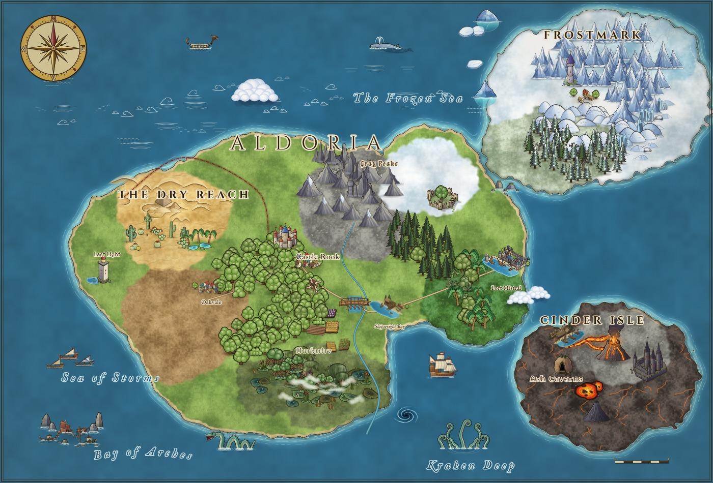
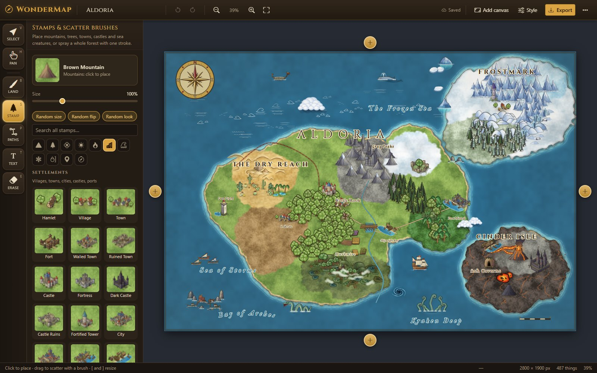
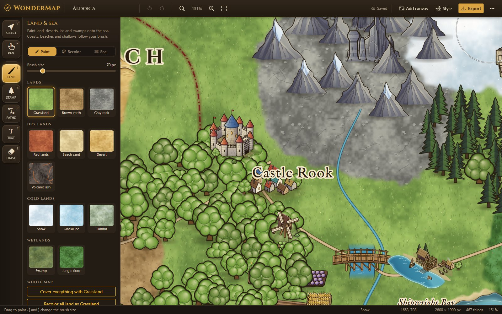
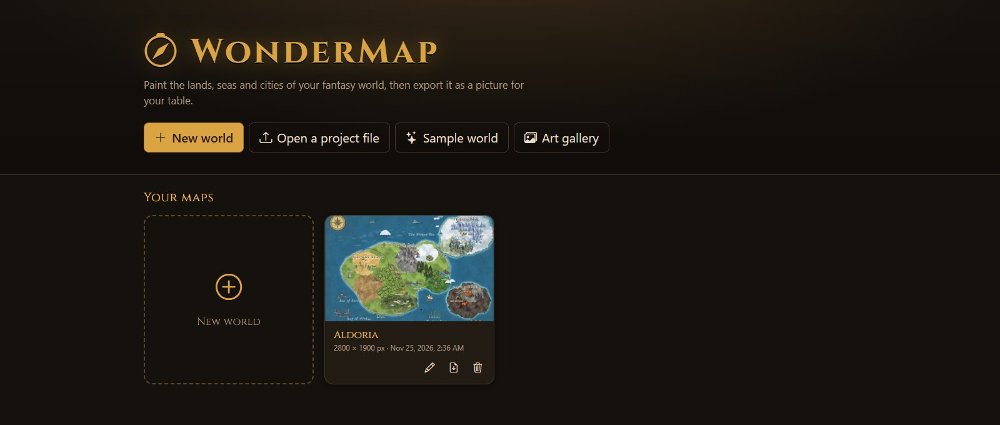

# WonderMap

**Paint your fantasy world.** WonderMap is a web-based map painter for D&D campaigns and any other
fantasy setting. Pick a brush, paint a world seen from above — seas, lands, mountains, forests,
deserts, volcanoes, castles, towns, ports, rivers, roads and names — and export it as a picture for
your table. The look follows classic fantasy cartography, in the spirit of
[Inkarnate](https://inkarnate.com/) and [Wonderdraft](https://www.wonderdraft.net/).



*Aldoria, the sample world that ships with the app, exported from WonderMap itself
(**Sample world** button on the title screen).*

> **Status: version 0.1.** The **world map** editor is finished and tested. Town, city, castle and
> dungeon maps are the next milestones — see [PLAN.md](PLAN.md).

**Contents:** [Screenshots](#screenshots) · [Features](#features) · [Quick start](#quick-start) ·
[Using the editor](#using-the-editor) · [Project layout](#project-layout) ·
[Adding art](#adding-art-for-example-sea-serpents) · [Tests](#tests-and-quality-checks) ·
[Good to know](#good-to-know) · [Documentation](#documentation)

---

## Screenshots

| | |
|---|---|
|  |  |
| *Stamps: pick a category, click to place or drag to scatter. The round **+** buttons on the edges of the map add more canvas.* | *Zoomed in with the Land & Sea palette. Every tree, castle and mountain is drawn by code.* |



*The title screen: your maps with thumbnails, plus **New world**, **Open a project file**, **Sample world**
and the **Art gallery**.*

## Features

| Area | What you can do |
|------|-----------------|
| **Land and sea** | Paint land onto open sea with a round brush (8–400 px). 12 terrains: Grassland, Brown earth, Red lands, Gray rock, Beach sand, Desert, Swamp, Snow, Glacial ice, Tundra, Jungle floor and Volcanic ash. Modes *Paint*, *Recolor* (change the terrain, keep the coast) and *Sea* (turn land back into water), plus whole-map fills. Coasts get an ink outline, shallow water, ripples and a sandy beach automatically. |
| **Stamps** | **239** symbols in 11 categories: mountains, hills and rocky crags; forests and trees; vegetation and farmland; desert; volcanoes and caverns; settlements (hamlets to castles, ports and shipyards); the sea (ships, shipwrecks, a wrecked shipyard, sea serpents, a kraken); ice; swamp; landmarks (towers, bridges, temples); and map decor (compass roses, scale bar, clouds). Each stamp can be resized, rotated, flipped and re-rolled to another look. |
| **Scatter brushes** | **63** brushes paint a whole forest, mountain range, dune field, vineyard or reed bed in one stroke, with an adjustable radius and random size, flip and look. |
| **Paths** | Rivers, roads, trails, borders and sea routes: drag to draw, then select the line to reshape it. |
| **Names** | 12 lettering styles (continent, region, city, town, village, sea, mountain, wild, landmark, ancient, dungeon, title) in 7 fantasy fonts, with curved text, size, rotation and letter spacing. |
| **More canvas** | Grow the map on any side at any time (top bar button or the **+** handles on the map edges). The new area is open sea and nothing you painted moves. |
| **Select and edit** | Click, drag a box, move, scale, rotate, duplicate, reorder and delete. Undo and redo (100 steps) cover everything, even adding canvas. |
| **Looks** | Two themes (*Wonder* — rich colour; *Parchment* — aged paper), three borders (none, simple, ornate), an optional grid, and switches for beaches, shallows and coast roughness. |
| **Export** | The **whole map** as PNG, JPEG or WebP at ×0.5 to ×4 (up to 64 megapixels), with or without the grid. |
| **Save and share** | Autosave to the Node backend, a library with thumbnails, project files (`.wondermap.json`) you can download and open again, and the ready-made sample world. |

All artwork is **generated by code** (Canvas 2D). There are no image files to download, license or
keep in sync. Every illustration lives in the dedicated [`illustrations/`](illustrations) folder,
apart from the editor code, so adding a new creature is a one-file job (see
[below](#adding-art-for-example-sea-serpents)). **[ASSETS.md](ASSETS.md)** shows a picture of every
terrain, symbol, brush, path, label style, font, theme and frame, and is kept up to date by
`npm run assets`.

**Stack:** Vite + React 19 + TypeScript, Bootstrap 5, Zustand and Canvas 2D in the browser;
Node.js + Express 5 with file storage on the server.

## Quick start

Requirements: **Node.js 20.19 or newer** (developed on Node 24) and npm.

```bash
npm install     # installs every workspace (illustrations, client, server)
npm run dev     # API on http://localhost:4000 + Vite on http://localhost:5173
```

Open <http://localhost:5173>. Press **Sample world** to look around, or **New world** to start painting.

One Node process that serves the app **and** the API (how you would run it for real):

```bash
npm run build   # type-checks and builds client/dist and server/dist
npm start       # http://localhost:4000
```

### Scripts

| Command | What it does |
|---------|--------------|
| `npm run dev` | API (4000) and Vite (5173) with hot reload |
| `npm run build` | Type-check and build the client and the server |
| `npm start` | Run the built server; it also serves `client/dist` |
| `npm test` | Unit and API tests of every workspace (Vitest) |
| `npm run test:e2e` | Build, then drive the real app in a browser (Playwright) |
| `npm run typecheck` | `tsc` over the illustrations, client, server and e2e projects |
| `npm run lint` | oxlint |
| `npm run check:art` | Reports symbols whose drawing is cut off at the edge of its box (needs `npm run dev -w client` running) |
| `npm run assets` | Redraws every illustration into [ASSETS.md](ASSETS.md) and `docs/assets/` (about 20 s; run it after any art change) |
| `npm run shot -- <url> <out.png>` | Headless screenshot helper for visual checks |

### Configuration

| Variable | Default | Used by |
|----------|---------|---------|
| `PORT` | `4000` | server |
| `DATA_DIR` | `server/data` | server — maps are stored in `<DATA_DIR>/maps/` |
| `CLIENT_DIST` | `client/dist` | server — the built client it serves (with a single-page-app fallback) |
| `BODY_LIMIT` | `40mb` | server — largest request body |
| `WONDERMAP_API` | `http://localhost:4000` | Vite dev server — where `/api` is proxied |

## Using the editor

1. **New world** on the title screen: choose a name, a size and a look. Or open the **Sample world**.
2. **Land** (`B`): choose a terrain and paint over the blue sea. `[` and `]` change the brush size.
   *Recolor* repaints land without touching coasts; *Sea* turns land back into water.
3. **Stamp** (`S`): pick a category, then **click** to place one symbol or **drag** with a scatter
   brush to spray a forest or a mountain range. The *Random size / flip / look* chips keep it natural.
4. **Paths** (`P`): drag to draw a river, road, trail, border or sea route.
5. **Text** (`T`): click on the map, type a name and press `Enter`. The *Curve* slider bends it along
   an arc, which is how seas and mountain ranges are usually named.
6. **Select** (`V`): click or drag a box to pick things, then move, resize, rotate, duplicate or delete
   them. The panel next to the map shows the properties of the selection.
7. Need more room? **Add canvas** (top bar, or the **+** handles on the edges of the map).
8. **Export** saves the whole map as an image. **Style** changes the theme, border and coastline options.

Your work is saved automatically (the top bar shows *Saving…* / *Saved*).

### Shortcuts

| Key | Action | Key | Action |
|-----|--------|-----|--------|
| `V` | Select | `H` | Pan |
| `B` | Land & sea brush | `S` | Stamps and scatter brushes |
| `P` | Paths | `T` | Text |
| `E` | Eraser | `[` / `]` | Smaller / larger brush |
| `Ctrl+Z` | Undo | `Ctrl+Y` or `Ctrl+Shift+Z` | Redo |
| `Ctrl+S` | Save now | `F` or `Home` | Show the whole map |
| `+` / `-` | Zoom | Mouse wheel | Zoom at the pointer |
| `Space`+drag, middle or right mouse | Pan with any tool | Two-finger pinch | Zoom (touch screens) |

With the **Select** tool: `Shift`+click adds to the selection, `Alt`+drag moves a copy, double-click
renames a name or adds/removes a point on a path, arrows nudge by 1 px (`Shift`: 10 px), `Ctrl+D`
duplicates, `Ctrl+A` selects everything, `PgUp` / `PgDn` bring to front / send to back, `Delete`
removes, `Esc` clears the selection.

## Project layout

```text
WonderMap/
├── README.md  PLAN.md  TECH.md   Project docs (start here)
├── ASSETS.md                     A picture of every asset (generated: npm run assets)
├── illustrations/                ALL generated art: terrain, symbols, brushes, paths, labels, themes, frames, fonts
├── client/                       Vite + React app: editor UI, rendering engine, tools, document model
├── server/                       Node.js + Express API (file storage) and static hosting of the build
├── e2e/                          Playwright end-to-end tests
├── tools/                        Dev helpers (asset catalog generator, screenshot, art bounds check)
├── docs/assets/                  The pictures shown in ASSETS.md (generated)
├── docs/images/                  Screenshots used by this README
├── map_examples/                 Reference images for the target look (not used by the app)
└── prompts/                      The original project brief
```

[TECH.md](TECH.md) describes the architecture file by file.

## Adding art (for example, Sea Serpents)

All art is code in `illustrations/`, and the editor discovers it by folder, so new art needs **no**
changes anywhere else:

1. Create `illustrations/symbols/<category>/my-creature.ts` that default-exports `defineSymbol({ … })`.
2. Open `http://localhost:5173/#/gallery`: the new symbol is already there, and it appears in the
   editor's palette with a generated thumbnail.
3. Run `npm run assets` to add it to [ASSETS.md](ASSETS.md), and commit that file and `docs/assets/`
   with the new art. `npm test` fails until you do, so it cannot be forgotten.

The existing [sea serpents](illustrations/symbols/sea/sea-serpent.ts) are a ready-made starting
point. The complete guide (rules, helper functions, brushes, terrains, themes) is
[illustrations/README.md](illustrations/README.md).

## Tests and quality checks

```bash
npm test             # Vitest: art catalog, editor logic, the API, and that ASSETS.md is up to date
npm run typecheck    # tsc, strict, for every project
npm run lint         # oxlint (includes the React hooks rules)
npm run test:e2e     # real browser, production build, throw-away data folder
```

The end-to-end tests use the installed **Microsoft Edge** by default. Set `E2E_CHANNEL=chrome` for
Chrome, or `E2E_CHANNEL=chromium` after `npx playwright install chromium`. Details are in
[TECH.md](TECH.md#13-testing).

## Good to know

* **Storage.** Maps are JSON files in `server/data/maps/` (ignored by git). Back that folder up, or
  use **Download project file** in the editor's **⋯** menu.
* **No login.** The server is built for one person on a trusted machine. If you ever expose it to a
  network, put it behind a reverse proxy that adds authentication.
* **Export runs in your browser.** Large maps at ×3 or ×4 can take a while and need memory; the
  dialog only offers sizes up to 64 megapixels.
* **Fonts** come from [`@fontsource`](https://fontsource.org/) packages (SIL Open Font License) and
  are bundled, so the app works offline.
* **Browsers.** Developed and tested with Chromium-based browsers (Microsoft Edge). Other modern
  browsers should work but are not covered by the automated tests.
* **`map_examples/`** holds the reference pictures that define the target style. The app does not
  read them.

## Documentation

| File | Contents |
|------|----------|
| [README.md](README.md) | This file: what WonderMap is and how to run and use it |
| [PLAN.md](PLAN.md) | What has been done, what is left, decisions, and the verification log |
| [TECH.md](TECH.md) | Architecture, data formats, rendering pipeline, API, testing and extension recipes |
| [ASSETS.md](ASSETS.md) | A picture of every terrain, symbol, brush, path, label style, font, theme and frame (generated, kept current by `npm run assets`) |
| [illustrations/README.md](illustrations/README.md) | How to create and change art |
| [prompts/initial.md](prompts/initial.md) | The original brief |

## License

Private project — all rights reserved by the repository owner. All artwork is generated by the code in
this repository.
